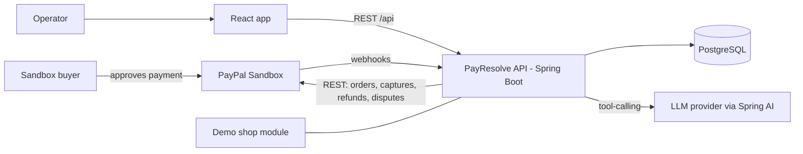
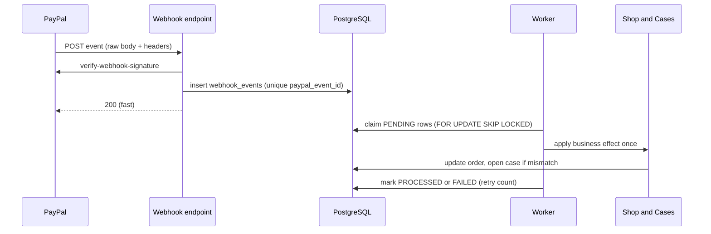

# PayResolve — Architecture

> Companion docs: `prd.md` (what and why), `phases.md` (when), `rules.md` (how we build), `memory.md` (living state).
> Versions below were current as of 2 Nov 2026. Confirm exact patch versions on start.spring.io and npm when scaffolding.

## 1. Purpose and scope

PayResolve is a merchant-side investigation tool for PayPal payment exceptions. It ingests PayPal webhooks, joins them with the merchant's own order, refund and shipment records, detects mismatches, builds an **evidence graph** per case, and runs an **AI investigator** that queries PayPal live and explains what is confirmed, what conflicts and what is missing. Any consequential action needs human approval.

In scope: PayPal Sandbox (Orders v2, captures, refunds, webhooks, disputes read where available), a small demo merchant shop, case detection, evidence graph, AI investigator, approval workflow, benchmark harness.
Out of scope: real money, production PayPal credentials, multi-tenant SaaS, other PSPs.

## 2. System context



## 3. Tech stack

| Layer | Choice | Notes |
|---|---|---|
| Language/runtime | Java 21 (LTS) | Spring Boot 4 baseline is JDK 17; use 21 for virtual threads and records |
| Backend | Spring Boot 4.1.1, Spring Framework 7 | Maven; Jackson 3 (`tools.jackson`) is the default JSON library |
| AI | Spring AI 2.0.x (supports Boot 4.0 and 4.1) | `ChatClient` + `@Tool` methods; provider selected by config |
| Security | Spring Security 7.x | session cookie + CSRF for the UI; webhook endpoint is public but signature-verified |
| DB | PostgreSQL 16+ | Flyway migrations; `ddl-auto=validate` |
| HTTP client | `RestClient` | No `RestTemplate`. Timeouts on every call |
| API docs | springdoc-openapi (version compatible with Boot 4) | Generates the OpenAPI spec the frontend types come from |
| Frontend | React 19 + TypeScript (strict) + Vite | |
| Styling | Tailwind CSS v4 | CSS-first config (`@import "tailwindcss"`, `@theme`), `@tailwindcss/vite` plugin |
| Data fetching | TanStack Query, React Router | |
| Grid | AG Grid Community / AG Studio | Exception queue; AG Grid sponsor prize target |
| Graph | `@xyflow/react` (React Flow) | Evidence graph |
| Validation | Zod (UI forms), Bean Validation (API) | |
| Tests | JUnit 5, Testcontainers, WireMock (PayPal stubs), Vitest, Testing Library, Playwright (one smoke path) | |
| Tooling | Postman collection, ngrok or Cloudflare Tunnel (dev), Docker Compose, GitHub Actions | |
| Hosting | Render: Docker web service (API), static site (UI) | Paid via hackathon credits with free-plan fallback; sponsor prize target |

Partner targets: PayPal, APIMatic Context Plugin, AG Studio (AG Grid prize), Render, Postman. (Skipping Bryntum, Elastic, Zapier, Astropods, KERNEL, Channel3).

## 4. Repository layout

```
payresolve/
  backend/               Spring Boot app (Maven)
  frontend/              Vite + React + TS + Tailwind v4 (built by teammate; mock data & localStorage auth; wiring to API)
  docs/                  architecture.md memory.md phases.md prd.md rules.md
  infra/                 docker-compose.yml, render.yaml
  postman/               collection + environment (no secrets)
  .env.example
  LICENSE                MIT (or Apache-2.0)
  README.md
```

## 5. Backend modules

Package by feature under `com.payresolve`. Modules talk through public service interfaces and domain events, not each other's repositories.

| Module | Responsibility |
|---|---|
| `paypal` | OAuth token cache, Orders/Captures/Refunds/Disputes clients, webhook signature verification. The only module that calls PayPal |
| `ingest` | Public webhook endpoint, durable event inbox, dedupe, async worker with retries |
| `shop` | Demo merchant: products, orders, order status, refunds, shipments, fault-injection switches |
| `cases` | Detectors, case lifecycle, severity, SLA clock |
| `evidence` | Evidence items, graph builder, timeline |
| `investigator` | Spring AI agent, read-only tools, structured report, verifier |
| `actions` | Proposed actions, approval, idempotent execution |
| `audit` | Append-only audit log |
| `common` | Money type, ids, error model, clock |

Dependency direction: `ingest` → `shop`/`cases`; `cases` → `evidence`; `investigator` → read APIs of `evidence`, `paypal`, `shop`; `actions` → `shop`, `paypal`. `investigator` never depends on `actions`.

## 6. Key flows

### 6.1 Checkout and capture
1. UI asks `shop` to create an order. `shop` calls `paypal` to create a PayPal order with `custom_id` = shop order id.
2. Buyer approves with the sandbox personal account.
3. Server captures (`/v2/checkout/orders/{id}/capture`). The UI never captures on its own.
4. Shop order moves to `AWAITING_CONFIRMATION`. It becomes `PAID` only when the verified webhook is processed (this is what lets the demo break on purpose).

### 6.2 Webhook ingestion



Rules: persist before processing; a duplicate event id inserts nothing and returns 200; processing is safe to retry; out-of-order events are tolerated by re-reading state from PayPal when needed.

For local development and testing with real PayPal Sandbox webhooks, expose the backend via Cloudflare Tunnel:
`cloudflared tunnel --url http://localhost:8080`, set `APP_PUBLIC_URL=https://<tunnel>.trycloudflare.com`, and register `https://<tunnel>.trycloudflare.com/api/webhooks/paypal` as the webhook URL with `PAYPAL_WEBHOOK_ID` in `.env`.

### 6.3 Detection
Detectors run after each processed event and on a schedule. Each detector is a pure function over a snapshot `(paypalState, shopState, events)` and returns zero or more findings. A finding opens or updates a case, keyed by `(caseType, paypalOrderId)` so reruns do not create duplicates.

| Case type | Rule |
|---|---|
| `PAID_NOT_MARKED` | PayPal capture `COMPLETED`, shop order not `PAID` after the grace period |
| `DUPLICATE_EVENT` | Same event delivered more than once, or a business effect attempted twice |
| `AMOUNT_MISMATCH` | Captured amount or currency differs from order total (compared in minor units) |
| `REFUND_MISMATCH` | PayPal refund state differs from shop refund state |
| `ORPHAN_CAPTURE` | Capture with no matching shop order |
| `DISPUTE_EVIDENCE_GAP` | Dispute (real or labelled fixture) lacks evidence required for its reason |

### 6.4 Investigation
1. Operator opens a case and clicks Investigate.
2. `investigator` runs a `ChatClient` with read-only tools (below), a step cap and a timeout.
3. The model returns a structured `InvestigationReport`.
4. A deterministic **verifier** checks that every cited record id exists and that stated amounts match the records. Failing statements are dropped or the report is marked partial.
5. Every tool call is stored in `investigation_steps` and shown in the UI.

Tools (all read-only): `getPaypalOrder`, `getCaptureDetails`, `getRefundDetails`, `listWebhookEventsForOrder`, `getShopOrder`, `getShipment`, `getCaseEvidence`, `getDisputeIfAny`.

```json
{
  "status": "CAUSE_FOUND | CAUSE_NOT_DETERMINED",
  "confirmed": [{ "statement": "...", "evidenceIds": ["..."] }],
  "conflicts": [{ "statement": "...", "evidenceIds": ["..."] }],
  "missing": [{ "item": "...", "why": "..." }],
  "recommendedAction": { "type": "SYNC_ORDER_STATUS | HOLD_REFUND | REQUEST_REVIEW | NONE", "rationale": "...", "evidenceIds": ["..."] }
}
```

### 6.5 Actions
The AI can only propose. `actions` stores a proposed action with an idempotency key. An operator approves or rejects. Execution is idempotent and audited. Money-moving actions are not implemented in v1; `SYNC_ORDER_STATUS`, `HOLD_REFUND` (a flag) and `REQUEST_REVIEW` are.

## 7. Evidence graph model

Nodes: `PAYPAL_ORDER`, `PAYPAL_CAPTURE`, `PAYPAL_REFUND`, `WEBHOOK_EVENT`, `SHOP_ORDER`, `SHIPMENT`, `DISPUTE`, `DISPUTE_EVIDENCE`, `OPERATOR_ACTION`.
Edges: `CAPTURES`, `NOTIFIED_BY`, `FULFILLS`, `REFUNDS`, `DISPUTES`, `PROVES`, `ACTED_ON`.
Each node carries `source` (PAYPAL | SHOP | SYSTEM), `observedAt`, `externalId`, and `status`. Edges that should exist but do not render as dashed "missing" nodes. The graph is derived at read time from evidence items; it is not a separate source of truth.

## 8. Data model (PostgreSQL)

| Table | Key columns |
|---|---|
| `webhook_events` | id, paypal_event_id (unique), event_type, resource_id, raw_body, headers_json, verified, status, attempts, delivery_count, received_at, last_received_at, event_created_at, custom_id, paypal_order_id, processed_at, last_error |
| `shop_orders` | id, paypal_order_id, status, total_minor, currency, customer_label, created_at, updated_at (CHECK `total_minor >= 0`) |
| `shop_order_items` | id, shop_order_id (FK), product_id (FK), quantity (CHECK `quantity > 0`), unit_price_minor (CHECK `unit_price_minor >= 0`) |
| `payments` | id, shop_order_id, paypal_capture_id, amount_minor, currency, status, captured_at (CHECK `amount_minor >= 0`) |
| `refunds` | id, payment_id, paypal_refund_id, amount_minor, status, source (PAYPAL/SHOP) (CHECK `amount_minor >= 0`) |
| `shipments` | id, shop_order_id, carrier, tracking_ref, status, delivered_at |
| `cases` | id (`PR-xxxx` from `case_number_seq`), type, status, severity, paypal_order_id, shop_order_id, opened_at, resolved_at |
| `case_evidence` | id, case_id, kind, source, external_id, payload_json, observed_at |
| `investigations` | id, case_id, status, report_json, model, started_at, finished_at |
| `investigation_steps` | id, investigation_id, tool, args_json, result_digest, started_at, ms |
| `proposed_actions` | id, case_id, type, payload_json, idempotency_key (unique), status, proposed_by, decided_by, decided_at |
| `audit_log` | id, at, actor, action, subject_type, subject_id, details_json (append-only via `trg_audit_log_immutable`) |
| `products` | id, name, description, price_minor, currency, stock |
| `demo_fault_switches` | id, fail_webhook_handler, drop_webhook, alter_order_total, duplicate_delivery, updated_at |
| `users` | id, username (unique), email, password_hash, role, created_at, updated_at |
| `password_reset_tokens` | id, user_id, token (unique), expires_at, used_at, created_at |
| `benchmark_runs` | id, run_at, total_cases, passed_cases, precision_pct, recall_pct, avg_duration_ms, results_json |
| `keepalive` | id, pinged_at |

### Hardening, Sequences, and Row Level Security (V5)
- **Sequence Generation:** `case_number_seq` generates sequential IDs formatted as `PR-0001`, `PR-0002`...
- **Delivery Counting:** Webhook duplicates increment `delivery_count` and refresh `last_received_at` without re-executing business effects.
- **Audit Immutability:** Trigger `trg_audit_log_immutable` strictly forbids any `UPDATE` or `DELETE` on `audit_log`.
- **Database-Level Check Constraints:** Negative amounts are strictly prevented via `chk_shop_orders_total`, `chk_payments_amount`, and `chk_refunds_amount`.
- **Row-Level Security (RLS) Lockdown:** RLS is enabled on all tables (`rowsecurity = true`). Default table grants are revoked from `anon` and `authenticated`; only `keepalive` allows SELECT/INSERT for external ping healthchecks.
- **Precision:** Money is stored as `BIGINT` minor units plus an ISO currency code. No floats anywhere.
## 9. API surface (all under `/api`)

| Endpoint | Purpose |
|---|---|
| `POST /webhooks/paypal` | Public, signature-verified ingestion |
| `GET /cases`, `GET /cases/{id}` | Queue and case detail |
| `GET /cases/{id}/graph`, `/timeline` | Evidence graph and timeline |
| `POST /cases/{id}/investigate`, `GET /investigations/{id}` | Run and read an investigation |
| `POST /cases/{id}/actions`, `POST /actions/{id}/approve`, `/reject` | Propose and decide |
| `POST /shop/orders`, `/shop/orders/{id}/capture` | Demo shop checkout |
| `POST /demo/faults` | Demo-only fault switches (drop webhook, fail handler, change amount) |
| `GET /benchmark/runs`, `POST /benchmark/run` | Run and view the seeded benchmark |

Errors use RFC 9457 `ProblemDetail`. The OpenAPI spec is the contract; frontend types are generated from it.

## 10. Security

- Secrets only in environment variables. `.env.example` is committed, real values never.
- Webhook endpoint verifies PayPal's signature using `PAYPAL_WEBHOOK_ID`; unverified events are stored as `verified=false` and never processed.
- Operator login with a session cookie, CSRF enabled; roles `VIEWER` (read-only demo access for judges) and `OPERATOR` (can approve).
- Investigator tools are read-only and return trimmed payloads. Prompt inputs are treated as untrusted data.
- All data is synthetic sandbox data. No real card data, no real customer PII.
- Log redaction for tokens, secrets and authorization headers.

## 11. Reliability and idempotency

- Unique `paypal_event_id` makes ingestion idempotent; the worker uses `FOR UPDATE SKIP LOCKED` and bounded retries with backoff.
- Business effects (mark paid, sync status) are guarded by a state check plus a unique effect key, so replaying an event cannot apply it twice.
- PayPal call failures use short timeouts and one retry with jitter; token refreshed before expiry.
- If the LLM is unavailable, the case page still shows the graph, timeline and rule-based findings; only the AI panel degrades.

## 12. Observability

Structured JSON logs with `caseId`, `eventId`, `paypalOrderId` in MDC; Actuator health and metrics (`webhook.received`, `webhook.duplicate`, `case.opened`, `investigation.ms`, `verifier.rejected`); the Investigator step log in the UI doubles as a trace for the demo.

## 13. Configuration

| Variable | Purpose |
|---|---|
| `PAYPAL_BASE_URL` | `https://api-m.sandbox.paypal.com` |
| `PAYPAL_CLIENT_ID`, `PAYPAL_CLIENT_SECRET` | Sandbox REST app |
| `PAYPAL_WEBHOOK_ID` | For signature verification |
| `DATABASE_URL`, `DB_USER`, `DB_PASSWORD` | PostgreSQL |
| `AI_PROVIDER`, `AI_API_KEY`, `AI_MODEL` | LLM provider via Spring AI |
| `OPERATOR_USERNAME`, `OPERATOR_PASSWORD`, `VIEWER_PASSWORD` | Demo logins |
| `APP_PUBLIC_URL` | Used for approval return URLs and webhook registration |

## 14. Testing strategy

- Unit: detectors (table-driven, one test per scenario), Money, verifier.
- Integration: Testcontainers Postgres; WireMock stubs for PayPal; webhook replay test (same event N times, one business effect).
- Benchmark: 15 to 20 seeded cases with expected case types and expected cited evidence; run produces precision/recall and time-to-cause numbers stored in `benchmark_runs`.
- E2E: one Playwright smoke path: paid-not-marked case, investigate, approve action.

## 15. Sponsor & partner tool mapping

| Tool | Where it earns its place |
|---|---|
| PayPal | Sandbox Orders v2, Captures, Webhooks, and Disputes |
| AG Grid / AG Studio | Exception queue (filters, sorting, severity, SLA); AG Grid prize target |
| Render | Hosting for backend Docker web service and frontend static site (paid via hackathon credits with free-plan fallback) |
| Postman | Collection for the PayPal flow, fault scenarios, and webhook replays |
| APIMatic | APIMatic Context Plugin for API documentation / SDK context |

Skipped sponsors/partners: Bryntum, Elastic, Zapier, Astropods, KERNEL, Channel3.

## 16. Decisions and trade-offs

- **Modular monolith** over microservices: one deployable, faster to ship, still clean boundaries.
- **Rules detect, AI explains and investigates:** deterministic detection keeps the money story trustworthy; the AI adds live investigation and explanation, never silent action.
- **Derived graph:** no separate graph database.
- **Synthetic dispute fixtures** if the sandbox Disputes API cannot be exercised; labelled as such in the UI and docs.
